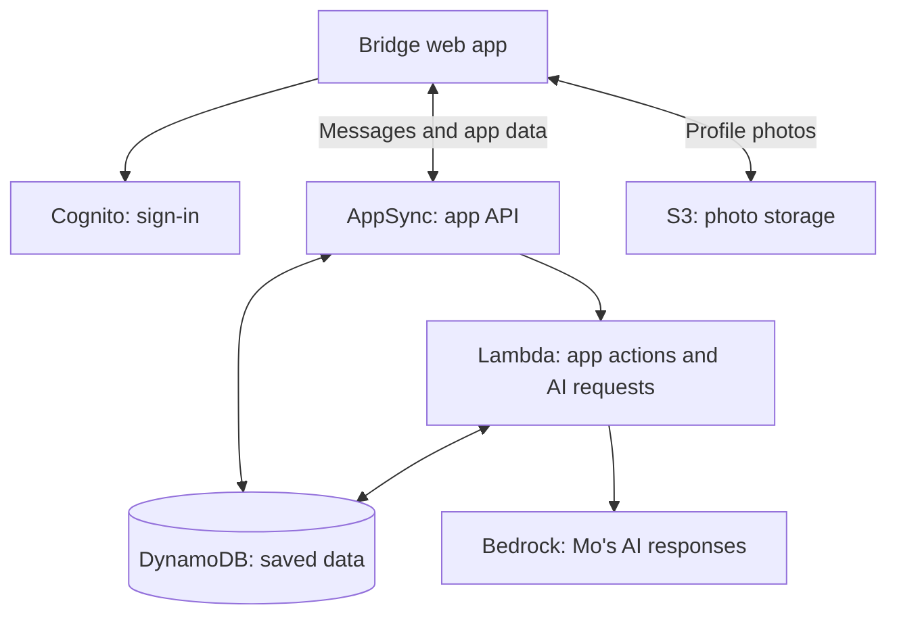

# Bridge: Preview. Practice. Go.

Bridge helps neurodivergent young adults practice everyday conversations and feel
more prepared to connect with people. Mo, an AI buddy, offers practice and
suggestions while the person stays in control.

**[Open Bridge](https://main.d36gmcisbn28tb.amplifyapp.com)** — create an account to get started.

Built for the **North American AI Challenge for Neurodiverse Learning**, in
partnership with **First Place AZ**.

## What you can do

- **Practice:** rehearse social situations with Mo and get feedback on your own goal.
- **Connect:** join interest circles, chat, and get optional reply ideas or tone checks.
- **Prepare:** see event details, plan ahead, and reflect afterward.
- **Feel comfortable:** use daily check-ins, breathing tools, themes, and text settings.

Mo suggests words; you decide what to send.

## How we built it

First Place AZ visits, research, and conversations with Josh Munoz informed the
app. We designed the flows in Figma and built the web app with React and Vite.
AWS handles sign-in, messages, storage, and reminders. Mo uses Claude through
Amazon Bedrock.

## Architecture



EventBridge also runs scheduled event reminders. AI requests run on the server;
[the AI guide](docs/AI_INTEGRATION.md) explains safety checks and saved context.

## Run locally

Use Node.js 22.12+ and npm. Backend setup requires an authorized AWS account and
Bedrock model access; the sandbox command creates real AWS resources.

```sh
cd app
npm ci
npx ampx sandbox --identifier <your-name> --once
npm run dev
```

The sandbox generates the backend configuration the app needs. From `app/`, run
`npm test`, `npm run lint`, and `npm run build` to check your changes.

See [setup and verification](app/README.md) or [deployment](docs/DEPLOYMENT.md)
for details. The separate [Figma prototype](figma-make/FIGMA_MAKE_CONTEXT.md)
is a design reference.

## AI disclosure

Claude helped with research, planning, prototype code, and tooling. Figma Make AI
helped with the prototype. Codex helped with production code, tests, reviews, and
documentation. We also used Kiro during the project. The team reviews the work
and makes the product decisions.
See [detailed credits](docs/AI_DISCLOSURE.md) and [prompt logs](AI_PROMPTS/).

## Team and contributions

**Ctrl Alt Elite** — graduate students at Arizona State University.

| Team member | Contributions |
|---|---|
| Dhyey Patel | Code and research. |
| Shreeya Bohra | Figma design, research, and app questions for Josh Munoz. |
| Rishi Kataria | Figma design, research, and field visit. |
| Tejas Shah | Code, research, and field visit. |
