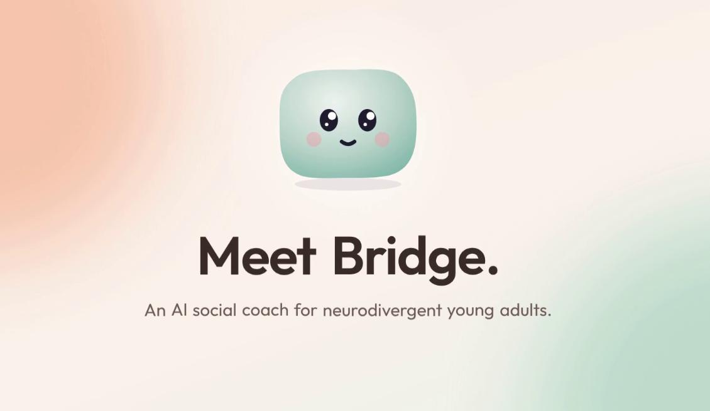
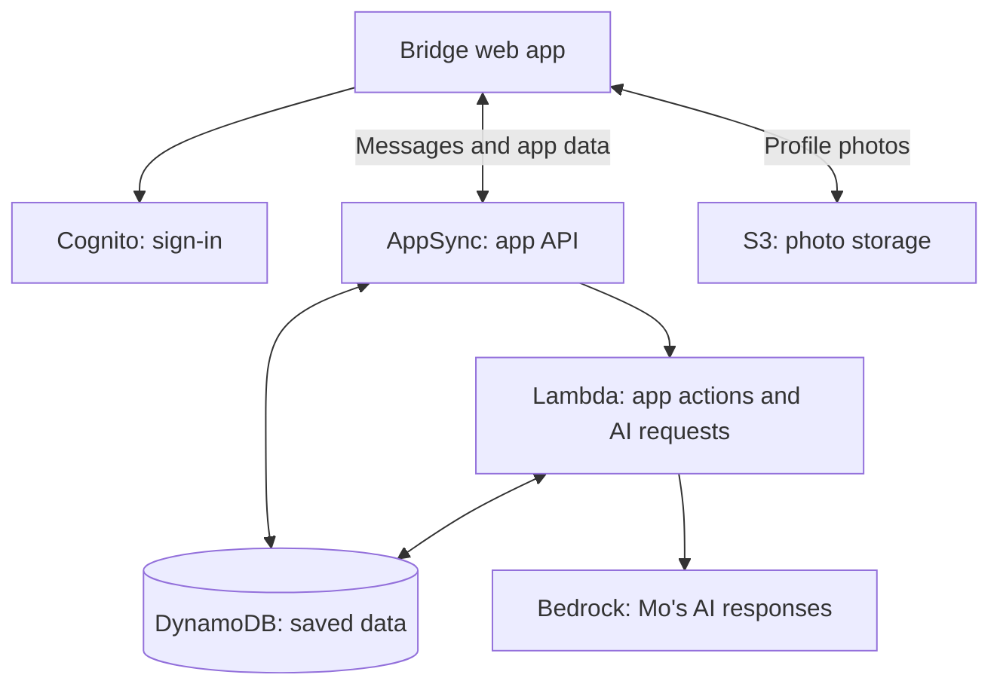

# Bridge: Preview. Practice. Go.

Bridge helps neurodivergent young adults practice everyday conversations and feel
more prepared to connect with people. Mo, an AI buddy, offers practice and
suggestions while the person stays in control.



**[Open Bridge](https://main.d36gmcisbn28tb.amplifyapp.com)** — create an account to get started.

Built for the **North American AI Challenge for Neurodiverse Learning**, in
partnership with **First Place AZ**.

## Links

- [Live app](https://main.d36gmcisbn28tb.amplifyapp.com)
- [Source code](https://github.com/Hero4440/Bridge)
- [Local setup and verification](app/README.md)
- [Deployment runbook](docs/DEPLOYMENT.md)
- [AI integration guide](docs/AI_INTEGRATION.md)
- [Figma/design brief](idea/Idea%201%20-%20Bridge.md)
- [Research and original brief](idea/Idea%201%20-%20Bridge.md#2-primary-research-partner-visits-n--2-visits-our-own-notes)

## What Bridge does

Bridge is an AI social coach for autistic and neurodivergent young adults, built with First Place AZ, who told us their residents want help socializing.

- **Daily check-in:** how I feel, what's coming up, and what I'd like help with (meeting new people, staying close to people I know, handling tricky moments, or talking at work or school). Home and today's practice follow the answer, and on overwhelmed days Home shows just one small thing.
- **Practice with Mo:** role-play real moments, including catching up with a friend, fixing a misunderstanding and asking a boss for help, at three levels (Guided, Light help, On your own) where support fades as skills grow. Every level has a box to answer in your own words.
- **My people:** family, roommates and coworkers the user already knows, with a gentle nudge to say hi in their own words.
- **Interest circles:** small groups with a daily topic, where reading without posting counts.
- **Messages:** a tone check before sending explains why something might sound harsh, and the user can still send it. Mo's reply ideas stay hidden until asked for, and the user can turn Mo's help down from Lots to When I ask.
- **Events:** people, sound and lighting shown before you go, a prep checklist, a breather, and a short reflection after.
- **Comfort and control:** calm color themes, large text, calm mode, plain words, and a trusted person who sees only what the user chooses.

## How we built it

First Place AZ visits, [research and the original brief](idea/Idea%201%20-%20Bridge.md),
and conversations with Josh Munoz informed the app. We designed the flows in Figma and built the web app with React and Vite.
AWS handles sign-in, messages, storage, and reminders. Mo uses Claude through
Amazon Bedrock.

## Architecture



EventBridge also runs scheduled event reminders. AI requests run on the server;
[the AI guide](docs/AI_INTEGRATION.md) explains safety checks and saved context.

## Run locally

Use Node.js 22.12+ and npm. Backend setup requires an authorized AWS account and
Bedrock model access; the sandbox command creates real AWS resources.

```sh
cd app
npm ci
npx ampx sandbox --identifier <your-name> --once
npm run dev
```

The sandbox generates the backend configuration the app needs. From `app/`, run
`npm test`, `npm run lint`, and `npm run build` to check your changes.

See [setup and verification](app/README.md) or [deployment](docs/DEPLOYMENT.md)
for details. The separate [Figma prototype](figma-make/FIGMA_MAKE_CONTEXT.md)
is a design reference.

## AI disclosure

Claude helped with research, planning, prototype code, and tooling. Figma Make AI
helped with the prototype. Codex helped with production code, tests, reviews, and
documentation. We also used Kiro during the project. The team reviews the work
and makes the product decisions.
See [detailed credits](docs/AI_DISCLOSURE.md) and [prompt logs](AI_PROMPTS/).

## Team and contributions

**Ctrl Alt Elite** — graduate students at Arizona State University.

| Team member | Contributions |
|---|---|
| Dhyey Patel | Code and research. |
| Shreeya Bohra | Figma design, research, and app questions for Josh Munoz. |
| Rishi Kataria | Figma design, research, and field visit. |
| Tejas Shah | Code, research, and field visit. |
